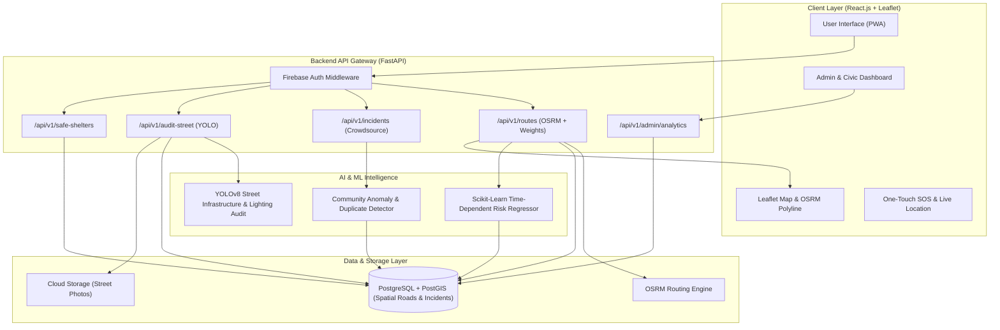
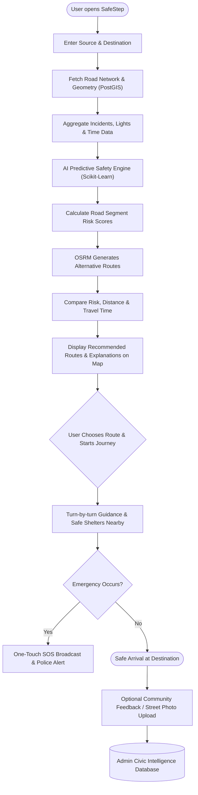

# SafeStep: AI-Powered Predictive Women's Journey Safety & Smart Urban Intelligence System

> **Reference Inspiration:** [SafeRoute Pune – Women's Safety Route Mapping System (Devpost)](https://devpost.com/software/saferoute-pune-women-s-safety-route-mapping-system)  
> **Core Motto:** *"Safer Journeys Begin with Smarter Decisions."*

---

## 1. Project Overview & Abstract

Women's safety during daily travel remains an urgent urban challenge, particularly along poorly illuminated corridors, isolated transit stops, and secluded pedestrian walkways. Most existing safety applications are reactive—triggering SOS alerts and sharing locations only after danger has occurred.

**SafeStep** transforms travel safety into a **proactive, predictive, and intelligent experience**. By segmenting street networks and applying machine learning over temporal patterns, historical incident reports, ambient lighting, and crowd density, SafeStep forecasts route safety before a journey begins and recommends safer alternatives.

---

## 2. System Architecture & Tech Stack



### Technology Matrix

| Layer | Technology | Key Responsibility |
| :--- | :--- | :--- |
| **Frontend UI** | React.js (Vite / CRA) + Tailwind CSS | Responsive, mobile-first PWA for navigation, incident reporting, and alerts |
| **Maps & Geospatial Display** | OpenStreetMap + Leaflet.js | Map rendering, route polylines, heatmaps, and shelter markers |
| **Backend API** | Python FastAPI | Asynchronous high-throughput REST APIs with automatic OpenAPI docs |
| **Spatial Database** | PostgreSQL + PostGIS | Road segment spatial indexing, distance radius queries, coordinate buffers |
| **Route Generation** | OSRM (Open Source Routing Machine) | Fast graph routing with custom safety weight penalty calculations |
| **Predictive ML** | Python + Scikit-Learn (Random Forest / XGBoost) | Time-dependent dynamic safety risk regression (2 PM vs. 7 PM vs. 11 PM) |
| **Computer Vision** | YOLO (YOLOv8) + OpenCV | Streetlight detection, pole condition, open manholes, dark spots |
| **Data Analytics** | Chart.js | Civic analytics, incident trends, streetlight repair status |
| **Authentication & Realtime** | Firebase Auth & Firestore | Secure JWT user verification & low-latency live location sharing |

---

## 3. The 9 Core Modules

```
SafeStep Architecture
├── 1. User Registration & Authentication (Firebase Auth)
├── 2. Interactive Map & Location Management (Leaflet + PostGIS)
├── 3. Community Incident Reporting (Crowdsourced + Anomaly Filter)
├── 4. AI Predictive Safety Analysis (Time-Dependent Risk Regressor)
├── 5. Street Image Detection (YOLOv8 + OpenCV Luminance Audit)
├── 6. Intelligent Route Recommendation (OSRM + Explainable AI)
├── 7. Last-Mile Public Transport Safety (Bus/Metro Corridor Auditing)
├── 8. Safe Shelter Discovery (Hospitals, Police, 24/7 Pharmacies)
└── 9. Admin & Government Civic Dashboard (Heatmaps & Public Works Metrics)
```

### Module Breakdown:

1. **User Registration & Authentication**:
   - Anonymous guest mode for privacy-conscious users.
   - Verified account sign-up via Firebase for submitting community hazard reports.
   - Trusted emergency contacts management.

2. **Interactive Map & Location Management**:
   - High-accuracy geolocation detection.
   - Road network segmented into distinct micro-segments (e.g., 100m to 250m blocks).
   - Color-coded safety overlay (🟢 Safe, 🟡 Moderate caution, 🔴 High risk).

3. **Community Incident Reporting**:
   - Geotagged incident reporting for: harassment, broken streetlights, deserted alleys, eve-teasing hotspots.
   - Image attachment and timestamping.
   - Time-decay function: older reports have their weights automatically attenuated over weeks/months unless reaffirmed.

4. **AI Predictive Safety Analysis (The Core Innovation)**:
   - Dynamic temporal risk scoring:
     - **2:00 PM:** Lower estimated risk (active commerce, daylight).
     - **7:00 PM:** Moderate estimated risk (dusk, crowded transit).
     - **11:00 PM:** Higher estimated risk (closed shops, sparse traffic, darkness).
   - Model outputs: Predicted Risk (0.0 to 1.0), Model Confidence (%), and Data Freshness score.

5. **Street Image Detection**:
   - Commuters or municipal workers upload street photos.
   - YOLO detects: `street_light_functional`, `street_light_damaged`, `isolated_pathway`, `open_drain`.
   - Luminance thresholding determines lux quality for night photography.

6. **Intelligent Route Recommendation**:
   - Queries OSRM for alternative routes (Route A: Fastest; Route B: Balanced; Route C: Safest).
   - Injects safety penalties into edge traversal weights.
   - **Explainable AI (XAI)** provides reasons: *"Route B adds 4 mins but covers 85% lit streets with 2 verified safe shelters on the way."*

7. **Last-Mile Public Transport Safety**:
   - Buffers 500m around bus stops and metro stations.
   - Rates pedestrian walkway connections to major arterial roads.

8. **Safe Shelter Discovery**:
   - Spatial nearest-neighbor queries identifying operational police stations, hospitals, 24/7 pharmacies, and verified women-assistance hubs.

9. **Admin & Government Civic Dashboard**:
   - Cluster analysis of recurring streetlight failures and crime complaints.
   - Direct exportable data for municipal road and electricity boards.

---

## 4. Complete End-to-End Workflow



---

## 5. Development Roadmap (3-Phase Plan)

### Phase 1: MVP Core (Foundational Navigation & Community)
- [x] PostGIS road segment database initialization.
- [x] OSRM integration for baseline routing between two coordinates.
- [x] React + Leaflet frontend interface with interactive map pins.
- [x] Anonymous and authenticated incident reporting API.
- [x] Basic SOS trigger with SMS/WhatsApp link dispatch.

### Phase 2: AI Predictive Engine & Route Comparison
- [x] Train Scikit-learn regression model on temporal incident + lighting datasets.
- [x] Segment safety scoring algorithm ($Score = w_1 \cdot Incidents + w_2 \cdot Light + w_3 \cdot Time + w_4 \cdot Crowd$).
- [x] Multi-route comparison UI (Fastest vs. Safest) with visual XAI explanation tags.
- [x] Safe Shelter spatial lookup engine (Hospitals, Police, Pharmacies).

### Phase 3: Computer Vision & Civic Intelligence
- [x] Fine-tune YOLOv8 on urban infrastructure datasets (streetlights, pavement).
- [x] Image upload endpoint for automatic street condition audit.
- [x] Last-mile transit stop risk auditing module.
- [x] Admin dashboard with Chart.js analytics for municipal authorities.
