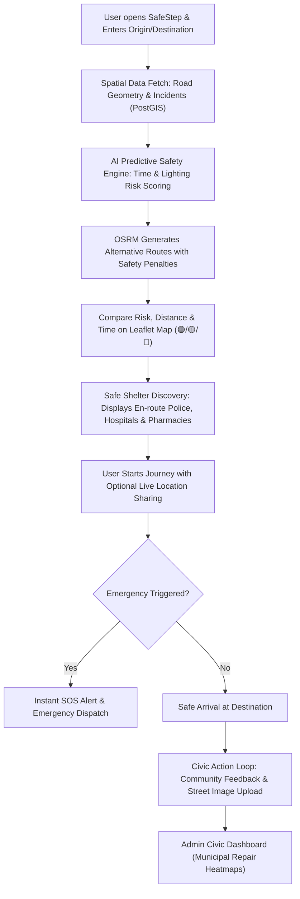

# SafeStep — Presentation Deck, Architecture & Speaker Script

> **Project Title:** SafeStep: AI-Powered Predictive Women's Journey Safety and Smart Urban Intelligence System  
> **Inspired by:** SafeRoute Pune – Women's Safety Route Mapping System (Devpost)  
> **Tagline:** *"Safer Journeys Begin with Smarter Decisions."*

---

## Slide 1: Title Slide (Cover)
* **Title:** SafeStep
* **Subtitle:** AI-Powered Predictive Women's Journey Safety and Smart Urban Intelligence System
* **Tagline:** *"Safer Journeys Begin with Smarter Decisions — Proactive, Not Just Reactive."*
* **Core Pillars:** OSRM & PostGIS Routing • Time-Dependent ML Regressor • YOLO Street Audit • Civic Action Portal
* **Presenter Information:** [Your Team Name / Presenter Names]

> **Speaker Notes:**  
> "Good day, everyone. Today, we present SafeStep — an AI-powered system that shifts women's travel safety from reactive panic buttons to predictive, intelligent risk awareness. By auditing urban infrastructure, learning temporal safety patterns, and prioritizing safe routes over just the fastest ones, SafeStep empowers commuters before their journey even begins."

---

## Slide 2: Problem Statement
**Why Do We Need SafeStep?**
* **The Reactive SOS Trap:** Existing women's safety apps activate only *after* distress via panic alarms and location sharing.
* **Nighttime Uncertainty:** Women frequently struggle to assess route safety after dark, where isolated alleys look identical to safe avenues on GPS apps.
* **Physical Infrastructure Deficits:** Poor street lighting, unmonitored footpaths, broken amenities, and secluded transit stops multiply risk.
* **Shortest-Path Algorithmic Bias:** Mainstream navigation tools (like Google Maps) optimize purely for distance and ETA, ignoring pedestrian vulnerability.
* **Core Problem:** *How can technology empower women to identify environmental risks before their journeys begin and choose genuinely safer routes?*

> **Speaker Notes:**  
> "Most safety apps give you an SOS button once a crisis is already unfolding. But walking down a pitch-dark, deserted road at 11 PM shouldn't happen in the first place. Google Maps will happily route you through an unlit alley just to save 90 seconds. SafeStep solves this algorithmic blind spot by factoring in human safety alongside travel time."

---

## Slide 3: Proposed Solution & Core Innovation
**Time-Dependent Road Safety Engine**
* **Dynamic Temporal Risk:** A street's safety risk is not static; it fluctuates drastically based on the hour, illumination, and pedestrian presence.
  * **2:00 PM (Low Risk - 🟢):** Broad daylight, active storefronts, heavy pedestrian footfall, open transit.
  * **7:00 PM (Moderate Risk - 🟡):** Dusk transitions, crowded transit junctions, varying streetlamp functionality.
  * **11:00 PM (High Risk - 🔴):** Closed shops, sparse civilian movement, dark spots; the engine penalizes this route segment.
* **Confidence & Data Freshness:** Explicitly presents model confidence scores and data recency indicators, making risk estimates transparent and explainable.

> **Speaker Notes:**  
> "Our defining innovation is the Time-Dependent Predictive Road Safety Engine. The same 200-meter street in front of a market is safe at 2 PM when shops are bustling, but could be high-risk at 11 PM when shutters are down and lighting is deficient. SafeStep's ML regressor dynamically adjusts road weights according to the clock."

---

## Slide 4: 8 Key System Features
1. **AI-Based Predictive Safety Scoring:** Micro-segment risk scores mapped to 🟢, 🟡, and 🔴 indicators.
2. **Community-Based Incident Reporting:** Anonymous reports of harassment, poor lighting, and hazards with auto-decay for stale historical reports.
3. **AI Street Condition Detection:** User-uploaded street photos analyzed via YOLO for broken lamps, blind spots, and damaged walkways.
4. **Intelligent Safe Route Recommendation:** Multi-route generation via OSRM with Explainable AI (XAI) rationale.
5. **Last-Mile Public Transport Safety:** Spatial safety audits within 500m of bus stops, metro exits, and pedestrian paths.
6. **Safe Shelter Discovery:** Real-time spatial discovery of open police kiosks, hospitals, 24/7 pharmacies, and verified help hubs.
7. **Emergency SOS & Live Location Sharing:** Instant trusted-contact alert dispatch with voluntary, end-to-end encrypted tracking.
8. **Civic & Municipal Dashboard:** Interactive heatmaps for city authorities to identify recurring streetlight and road defects.

> **Speaker Notes:**  
> "SafeStep is a complete ecosystem. It covers everything from crowdsourced reporting with auto-decay to prevent outdated data, to automated streetlight inspection via computer vision, all the way to discovering verified 24/7 safe shelters along your route."

---

## Slide 5: Technology Stack & 9 Core Modules

### Architecture Matrix
| Layer | Tech Stack | Role |
| :--- | :--- | :--- |
| **Frontend** | React.js, Tailwind CSS, Leaflet.js | Mobile-first responsive UI, interactive map pins & routing |
| **Backend API** | Python FastAPI | Asynchronous high-performance REST APIs |
| **Spatial Database** | PostgreSQL + PostGIS | Road geometry indexing and spatial radius buffers |
| **Routing Engine** | OSRM (Open Source Routing Machine) | Graph routing with custom safety penalty weightings |
| **Machine Learning**| Python & Scikit-learn | Multi-variable temporal safety risk regression models |
| **Computer Vision** | YOLOv8 + OpenCV | Automated detection of streetlights, dark spots, and road hazards |
| **Analytics & Auth**| Chart.js & Firebase Auth | Civic analytics dashboards and secure user authentication |

### The 9 Core Modules
1. User Registration & Authentication (Firebase Auth)
2. Interactive Map & Spatial Manager (Leaflet + PostGIS)
3. Community Incident Reporting (Crowdsourced + Spam Filter)
4. AI Predictive Safety Analysis (Temporal ML Model)
5. Street Image Detection (YOLOv8 Infrastructure Audit)
6. Intelligent Route Recommendation (OSRM + Explainable XAI)
7. Public Transport Safety Assessment (Last-mile transit buffer)
8. Emergency Assistance & Safe Shelters (SOS + Shelter Finder)
9. Admin Dashboard & Analytics (Municipal Civic Heatmaps)

---

## Slide 6: Complete End-to-End Workflow

> **Speaker Notes:**  
> "From the moment a commuter enters her destination, PostGIS queries the surrounding road geometry, our ML model assigns temporal risk weights, and OSRM generates alternative safe routes. While traveling, safe shelters are highlighted. If an emergency occurs, one-touch SOS triggers. Upon safe arrival, user contributions feed back into municipal repair heatmaps."

---

## Slide 7: 3-Phase Roadmap & Conclusion

### Development Roadmap
* **Phase 1: Core Foundation (MVP)**
  * Interactive Leaflet map, PostGIS road network integration, basic OSRM route generation, Firebase Auth, and incident reporting forms.
* **Phase 2: Predictive Engine & Comparisons**
  * Temporal Scikit-learn risk regressor, dynamic road segment scoring, multi-route comparison UI, and Safe Shelter discovery.
* **Phase 3: Vision & Civic Intelligence**
  * YOLO street condition detection, last-mile transit audits, and the Municipal Civic Intelligence Dashboard with Chart.js.

### Conclusion
> **"SafeStep transforms women's travel safety from reactive panic alerts into proactive, intelligent risk awareness."**  
> **"Safer Journeys Begin with Smarter Decisions."**

> **Speaker Notes:**  
> "By structuring our development into 3 concrete phases, SafeStep is both technically feasible and immediately impactful. We look forward to building cities where technology doesn't just record emergencies, but actively helps prevent them. Thank you!"
